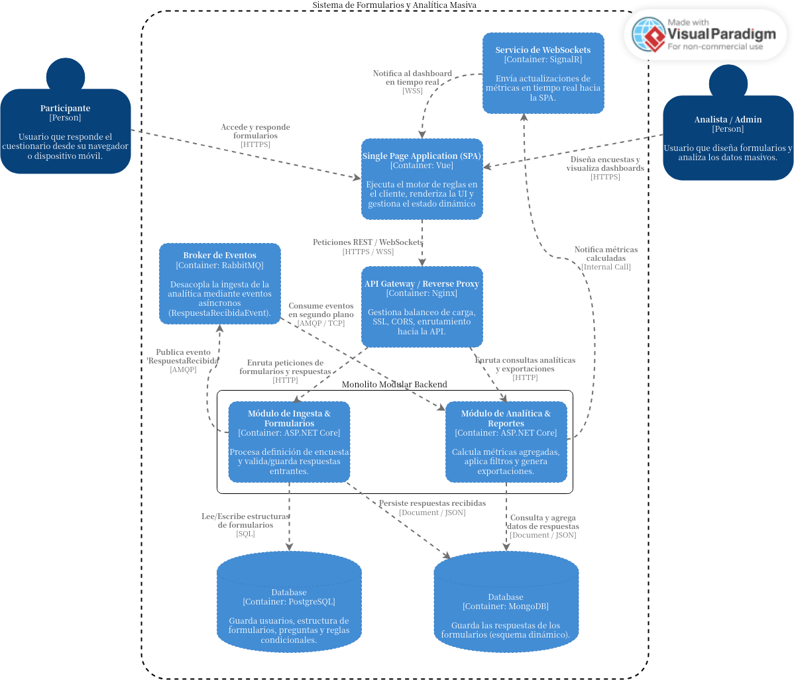

# Formule
Formule es un sistema de creación de formularios que tiene como objetivo
permitir crear, responder y visualizar los resultados de formularios y
cuestionarios de manera sencilla y entendible.

## ¿Qué problema resuelve?
Este sistema busca resolver la necesidad de crear cuestionarios o formularios
que los usuarios puedan llenar de manera intuitiva y cómoda, para luego, de
manera automática, mostrar la información obtenida y distintos tipos de
análisis directamente desde el sitio web y con solo presionar un par de
botones. De esta forma, el usuario que crea los formularios no necesita
procesar la información por su cuenta para la mayoría de informaciones
requeridas.

## Funcionalidades principales
Este permite que los formularios mantengan reglas que permitan mostrar algunas
respuesta de manera condicional en base a respuestas anteriores. De esta forma
el usuario solo ve las respuestas relevantes y se evitan confusiones.

Este sistema también tiene un enfoque en permitir la visualización detallada y
en tiempo real de los resultados de cada formulario, con filtros y operaciones
como agregaciones que permitan el procesamiento de datos de manera
instantánea.

Los datos de respuesta de un formulario también ofrecen la posibilidad de
exportarse a formatos como CSV o JSON, además de permitir realizar esta acción
a través de una API.

## Arquitectura
El estilo arquitectónico que del proyecto se basa en una arquitectura híbrida
desacoplada. El frontend consiste en una single page application (SPA). Este
frontend se comunica con el backend, que consiste en un monolito modular
separado en módulos claros, un módulo de ingesta y formularios y un módulo de
analítica. Este módulo de analítica consume eventos de una cola de mensajes
(event-driven architecture) en segundo plano y empuja las métricas
actualizadas al dashboard en tiempo real mediante WebSockets. El sistema
utiliza persistencia híbrida con dos bases de datos, una base SQL y otra noSQL
de tipo documental.

|Componente|Responsabilidad Principal|Relación con otros Componentes|
|---|---|---|
|Single Page Application (SPA) (Frontend)|Renderiza la interfaz, gestiona el estado dinámico y ejecuta el motor de reglas condicionales en el cliente.|Consume la API Gateway mediante HTTPS/WSS para enviar respuestas y recibir métricas.|
|API Gateway (Backend)|Actúa como punto único de entrada, gestionando autenticación, CORS, balanceo de carga y enrutamiento.|Recibe peticiones de la SPA y las enruta hacia Módulo de Ingesta o Módulo de Analítica.|
|Módulo de Ingesta & Formularios (Backend)|Gestiona el CRUD de formularios, valida reglas de negocio y persiste las respuestas recibidas.|Lee/escribe en BD Relacional y BD Documental; publica eventos en el Broker de Eventos.|
|Módulo de Analítica & Reportes (Backend)|Procesa agregaciones masivas de datos, aplica filtros dinámicos y genera archivos de exportación.|Escucha al Broker de Eventos, consulta la BD Documental y notifica al Servicio WebSockets.|
|Broker de Eventos (Backend)|Desacopla asíncronamente la ingesta de datos respecto al cálculo intensivo de métricas.|Recibe mensajes del Módulo de Ingesta y los entrega al Módulo de Analítica.|
|Servicio WebSockets (Backend)|Mantiene conexiones bi-direccionales persistentes para empujar actualizaciones al dashboard en tiempo real.|Recibe notificaciones del Módulo de Analítica y las transmite hacia la SPA.|
|Base de Datos Relacional (Backend)|Garantiza la integridad referencial de usuarios, estructuras de formularios y reglas condicionales.|Utilizada por el Módulo de Ingesta para lectura y escritura de metadatos del sistema.|
|Base de Datos Documental (Backend)|Almacena respuestas con esquemas flexibles y ejecuta consultas analíticas de lectura rápida.|Recibe inserciones del Módulo de Ingesta y consultas agregadas del Módulo de Analítica.|

## Herramientas utlizadas
- **Visual Paradigm Online** para diseñar y crear los diagramas UML,
  incluyendo diagrama de casos de uso, de actividades, de secuencia, de clases
  y de arquitectura.

- **Git** como sistema de control de versiones con el fin de darle seguimiento
  a los cambios individuales que se realizan al código y a la documentación.

- **GitHub** para almacenar el repositorio de Git del proyecto, junto con su
  archivo `README.md`, la gestión de tareas y la documentación del proyecto.

- **GitHub Projects** para organizar las tareas y etapas del proyecto, además
  de prioridades, fechas, roles, criterios de aceptación y estados de cada
  tarea.

- **GitHub Issues** para conectar las tareas de GitHub Projects con el
  repositorio de GitHub y darle seguimiento a estas a medida que se desarrolla
  el proyecto mediante commits y pull requests.

## Estado actual del proyecto
El proyecto se encuentra actualmente en la fase de validación arquitectónica y
planificación técnica, tras haber concluido con éxito el diseño conceptual y
la especificación detallada de requerimientos. Se ha consolidado la decisión
de implementar una arquitectura híbrida desacoplada basada en un monolito
modular con ingesta asíncrona por eventos (EDA) y persistencia políglota,
combinando almacenamiento relacional para la estructura de los formularios con
una base de datos documental para las respuestas dinámicas.

Asimismo, se cuenta con el paquete completo de modelado UML y arquitectura C4,
lo que ha permitido estructurar un backlog técnico priorizado a dos Sprints
con asignación de roles, fechas estimadas y estrategias de mitigación de
riesgos. El equipo está listo para dar inicio al Sprint 1, enfocando los
esfuerzos inmediatos en la orquestación del entorno con Docker Compose, la
formalización del contrato OpenAPI (Swagger) y la construcción del motor de
reglas condicionales en el cliente (SPA) para garantizar la evaluación de la
interfaz en menos de 100 ms.
